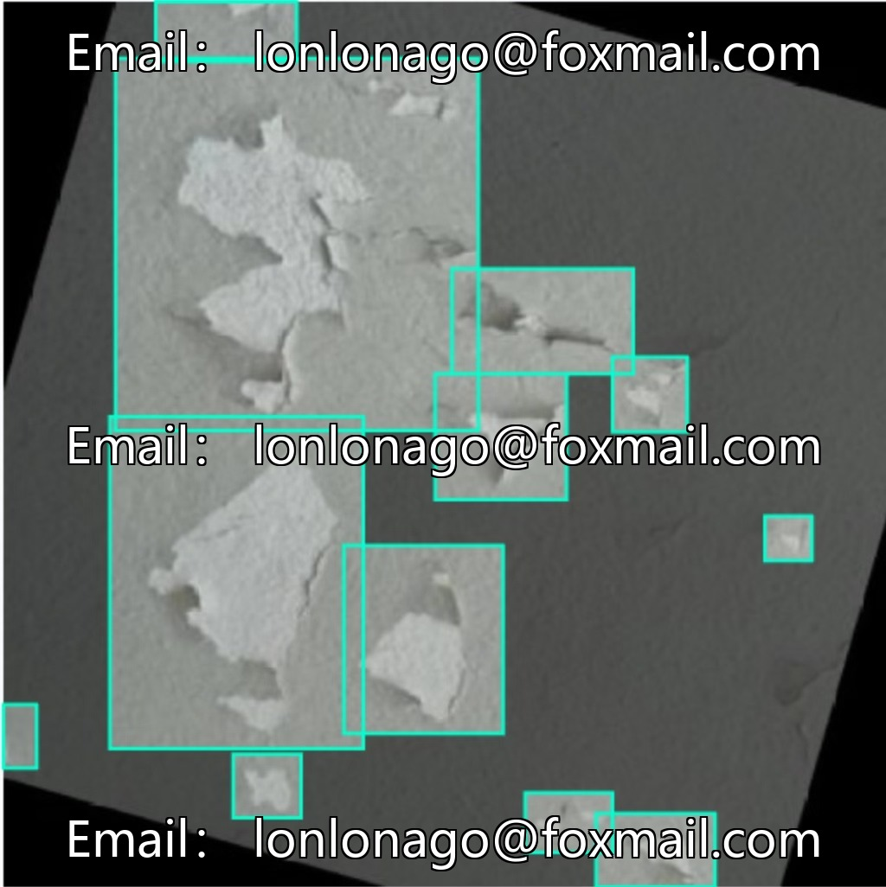
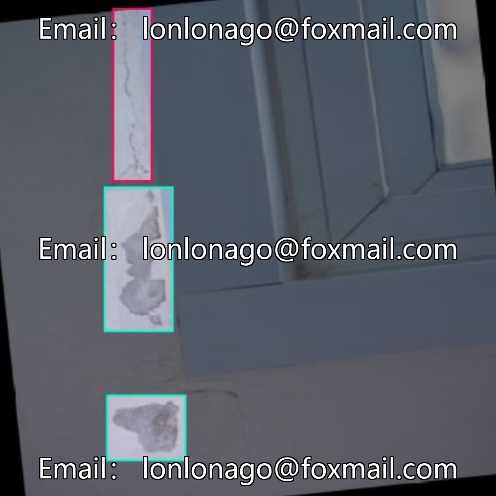
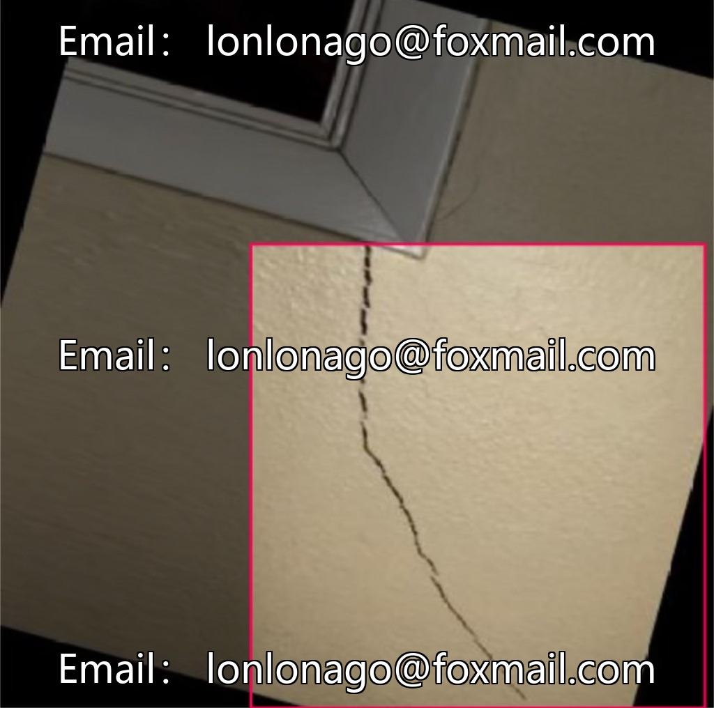
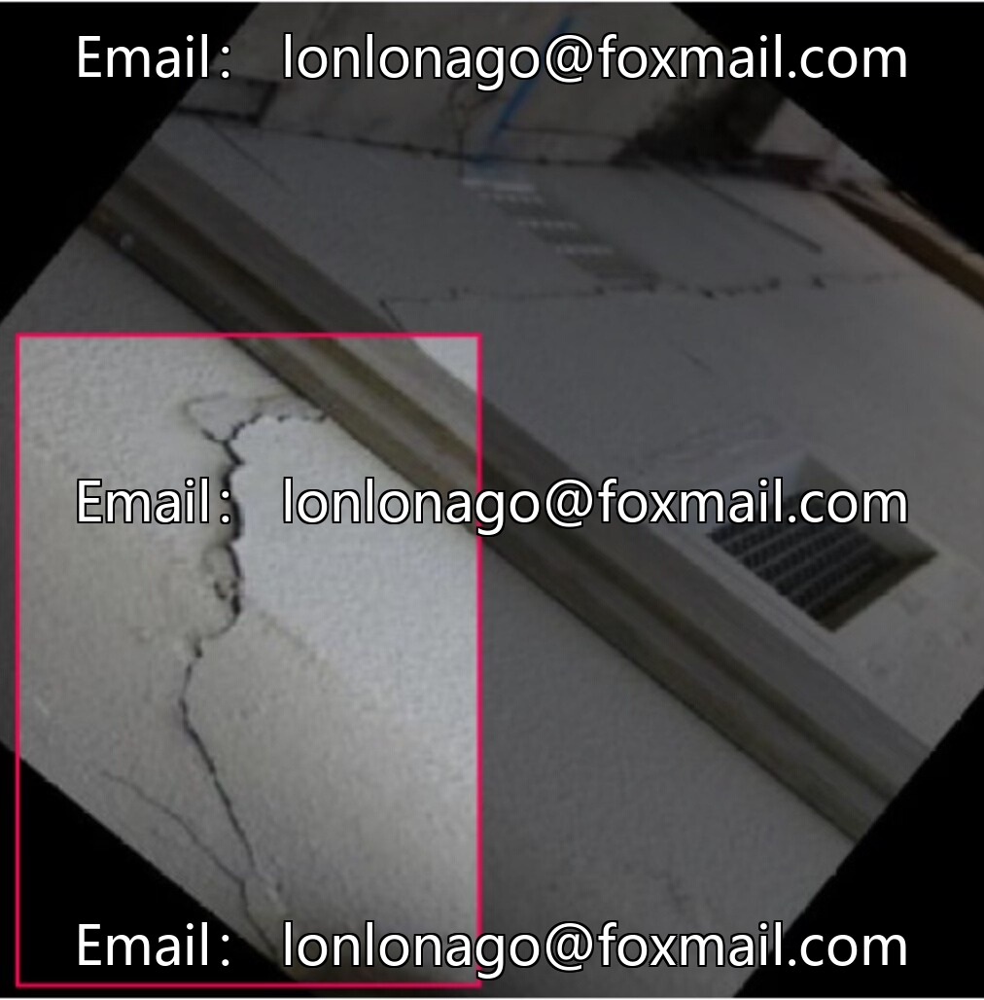

# High-precision Smart City Building Inspection and Identification Data Set, Wall Cracks Detection, Surface Crack Maps

## Body

High-precision Smart City Building Inspection and Identification Data Set, Wall Cracks Detection, Surface Crack Image Recognition, Engineering Quality Inspection Image Data Set, Issue No. 10381

The dataset contains 1300 annotations, covering 5 categories of targets: cracks, mold, peeling paint, stepped cracks, water infiltration. Formatted in YOLO, it is suitable for training algorithms for structural disease detection, intelligent engineering inspection, and the identification of damage in ancient buildings.

Data covers common diseases, category is in line with actual inspection, annotation is unified, directly used for model training, supports optimization of target detection models.

Virtual materials, once sold, are non-refundable.
Interested friends, click "I want" to proceed.

## Images

## Payment

Here is a pay link on Stripe ( https://buy.stripe.com/3cs8yP7sY87d0vu9AB ). Please contact me lonlonago@foxmail.com after funding $89, and I will send you a complete data files , thank you!

